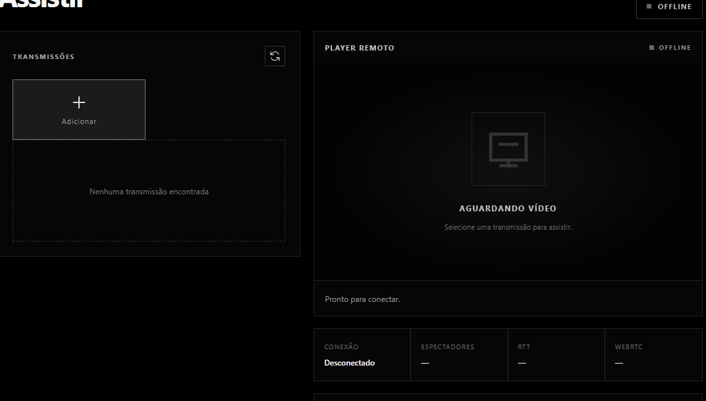
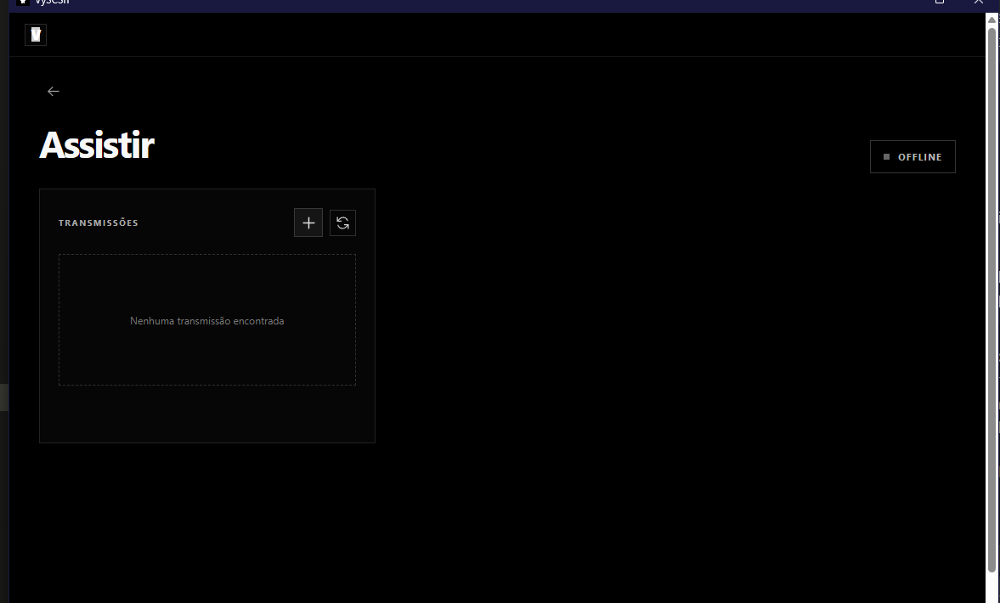

# VySCSh

**Compartilhamento de tela entre dois PCs Windows, feito por dois amigos.**

O VySCSh nasceu de uma ideia simples: assistir à tela de outro computador pela rede Radmin VPN, sem depender de um serviço de streaming ou de uma conta externa.

O projeto ainda é um MVP experimental, mas já dá para:

- transmitir uma janela ou monitor;
- assistir à transmissão em outro PC;
- escolher qualidade e áudio;
- usar descoberta automática ou informar o host manualmente;
- assistir em tela cheia ou Picture-in-Picture.

## Como é a experiência



Na tela inicial, basta escolher entre **Transmitir** e **Assistir**.



Na tela de assistir, o aplicativo procura os computadores disponíveis na rede. Também é possível adicionar um host manualmente pelo botão `+`.

## O que precisamos

- Dois PCs com Windows 10 ou 11.
- Radmin VPN instalado nos dois computadores.
- Os dois PCs na mesma rede do Radmin.
- Um monitor ou uma janela para compartilhar.

Para desenvolver ou gerar o instalador, também é necessário ter Node.js 22 ou mais recente.

## Usando o aplicativo

### No PC que vai transmitir

1. Abra o VySCSh e escolha **Transmitir**.
2. Selecione o monitor ou a janela.
3. Escolha a qualidade desejada.
4. Inicie a transmissão.
5. Compartilhe o IP do Radmin, a porta e a chave com o outro PC.

### No PC que vai assistir

1. Abra o VySCSh e escolha **Assistir**.
2. Aguarde o host aparecer na lista ou use o botão `+`.
3. Informe a chave da sala.
4. Clique no host para abrir o player.

A porta padrão é `47892`. Se o Windows perguntar sobre o firewall, permita o aplicativo na rede do Radmin. Não é necessário abrir portas no roteador.

## Baixar ou gerar o instalador

O instalador do Windows é gerado com:

```powershell
npm install
npm run package:win
```

O arquivo `.exe` aparece dentro da pasta `release/`.

Para rodar durante o desenvolvimento:

```powershell
npm install
npm run dev
```

## Desenvolvimento

O projeto usa:

- Electron;
- React;
- TypeScript;
- Vite;
- WebRTC;
- WebSocket para a sinalização.

Os principais diretórios são:

```text
src/main/       janela do Electron e servidor local
src/renderer/   interface e player
src/preload/    ponte segura com o Electron
src/shared/     tipos compartilhados
tests/          testes do servidor de sinalização
docs/           documentação do projeto
```

Antes de enviar mudanças, podemos conferir o projeto com:

```powershell
npm run check
npm test
npm run build
```

## Importante

Este é um projeto experimental e ainda estamos validando o uso em dois computadores reais. A rede Radmin é necessária nesta versão, e o áudio do sistema ainda pode variar de acordo com o Windows e o aplicativo transmitido.

Não compartilhe a chave da sala publicamente e transmita apenas conteúdo que você tenha autorização para compartilhar.

## Próximos passos

Estamos trabalhando em estabilidade, reconexão, testes entre PCs diferentes e uma experiência cada vez mais simples.

Veja o [ROADMAP](ROADMAP.md) para acompanhar as ideias do projeto.

## Autores

Feito por **VyktorCorner e Vyko**, como um projeto independente para aprender, testar e construir algo útil juntos.

## Licença

A licença do código ainda não foi definida.
