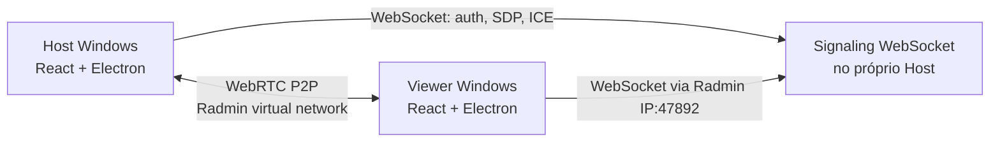

# Arquitetura v0.1 — Windows / Radmin

## Papéis

**Host:** servidor de sinalização (`src/main/signaling.ts`), captura (`desktopCapturer` / `getDisplayMedia`) e `RTCPeerConnection` com track de mídia por espectador.

**Viewer:** autentica no servidor do host via WebSocket e estabelece PeerConnection própria. Não necessita Proxmox.

**Radmin VPN:** fornece endereçamento e conectividade virtual entre os computadores. O app não controla o Radmin nem usa suas APIs privadas. Radmin Server/Remote Control não é necessário.

## Fluxo

1. Host seleciona interface, fonte de captura e gera uma chave aleatória.
2. Clicando em transmitir, a captura começa explicitamente.
3. O processo principal do Electron abre um WebSocket Server **somente no IPv4 selecionado**.
4. O renderer host conecta como `role: host`.
5. Viewer abre WebSocket no IPv4 Radmin do host, usando a chave.
6. Servidor anuncia `viewer-joined` ao host.
7. Host cria oferta, viewer responde; ambos trocam ICE candidates via servidor.
8. Pares estabelecem DTLS-SRTP; mídia via Radmin P2P (ou relay interno do próprio Radmin, se utilizado).

## Limites e decisões

- `MAX_VIEWERS = 4`, um servidor/sala por processo.
- TCP/47892 é signaling; WebRTC usa portas UDP negociadas dinamicamente.
- `iceServers: []`: candidatos locais para rede virtual. STUN e TURN ficam para M3.
- O navegador embarcado pode mascarar candidatos com mDNS; testes reais determinarão a compatibilidade com a VPN.
- Apenas o host inicia `offer`; a implementação atual não é Perfect Negotiation completa. Isso evita colisão de ofertas no fluxo básico.
- `getDisplayMedia` só ocorre após ação explícita do host.
- Ao encerrar o host, o signaling desconecta os espectadores e os tracks param.

## Interfaces de extensão

- Substituir signaling local por serviço Proxmox sem modificar a tela de captura.
- STUN/TURN será acrescentado à configuração de `RTCPeerConnection`.
- Login Discord substituirá `accessKey` por autorização de sessão no signaling.
- `src/shared/types.ts` é o contrato inicial. Versão do wire protocol: `1` (detalhamento em PROTOCOL.md).

## Limites de segurança

- O host só escuta no endereço selecionado; **não** em `0.0.0.0`.
- A rede Radmin e o segredo de sala são controles distintos.
- WSS, TLS, autenticação forte e rotatividade de permissões serão necessários antes de uso fora de redes confiáveis.
